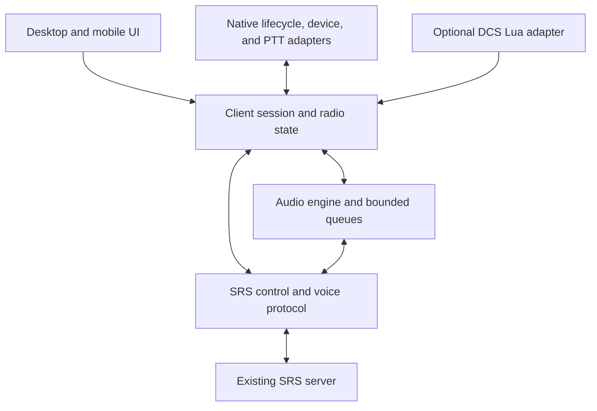

# Architecture

## Present implementation

This is a bootstrap workspace. Only `crates/srs-core` exists as a Rust library scaffold, with documentation and an unsafe-code prohibition. It has no protocol parser, networking, audio, UI, public API, or behavioral tests. The following architecture is a design target, not an inventory of implemented features.

## Boundaries

| Planned component | Responsibility | Exclusions |
|---|---|---|
| `srs-core` | Radio identities, eligibility rules, PTT/session state, configuration models | UI, native device handles, network I/O |
| `srs-protocol` | Bounded TCP JSON framing, models, UDP byte encoding/decoding, compatibility fixtures | Device capture, arbitrary protocol changes |
| `srs-client` | Session orchestration, reconnect, control updates, voice transport | UI framework dependencies |
| `srs-audio` | Codec adapters, jitter buffer, resampling, mixing, effects, bounded audio queues | UI state mutation, unbounded buffering |
| Platform adapters | Audio I/O, device changes, hardware PTT, permissions, lifecycle | Duplicated radio/protocol rules |
| Application UI | Responsive radio console, settings, diagnostics | Codec and routing decisions in callbacks |
| DCS adapter | Existing Lua export/update interfaces, later cockpit support | Rewriting every aircraft script at bootstrap |
| Optional server/gateway | Later compatible Rust relay; separate iOS wake-up service if required | Dependency for the first desktop/Android client |

Add crates when they have a concrete responsibility and implementation. Do not create empty packages for every planned box.

## Candidate technologies

- Rust with Tokio and Serde for asynchronous control/network work.
- libopus through a narrow audited binding for the established voice codec.
- CPAL as the initial device I/O candidate, validated against native routing needs.
- Slint as the initial cross-platform UI candidate.
- Kotlin/Java and Swift/Objective-C adapters where native lifecycle APIs require them.

These dependencies are not selected by the scaffold and are not in Cargo.lock. Confirm them through a physical-device spike before binding the product to a toolkit. Shared Rust does not remove platform-specific audio-session work.

## Threading and ownership

The client session owns connection state and applies typed commands/events. UI and platform adapters send commands rather than mutating shared global state. Audio callbacks consume/produce preallocated buffers through bounded queues. Encoding, decoding, network operations, logging, and configuration persistence execute outside hardware callbacks. Define queue limits and drop policy before wiring the audio path.

PTT is an explicit state machine. Disconnect, device failure, lifecycle interruption, and lost input ownership release transmission. Reconnect starts receive-only until a new valid transmit action. Distinguish microphone capture, local TX, server connectivity, and any available delivery evidence.

## Compatibility

The [protocol guide](docs/PROTOCOL.md) pins the initial reference and records known wire details. Use independent upstream fixtures and differential tests. Separate application version, settings schema, and SRS compatibility declaration. Preserve server policy; do not assume all servers permit external coalition operators.

DCS cockpit/terrain state belongs to a later adapter. A phone in TOC mode does not have a local DCS terrain engine. Desktop DCS integration and mobile standalone radio operation have different acceptance criteria.

## Repository layout

- Root Markdown: onboarding, agent rules, architecture, tasks, notices.
- `docs/`: scope, protocol, testing, platform, UI, reporting, and release guides.
- `crates/srs-core/`: the initial library scaffold.
- `scripts/check.py`: dependency-free local checks.
- `.github/`: CI and issue/PR templates.

Keep this inventory synchronized when actual modules are added.
