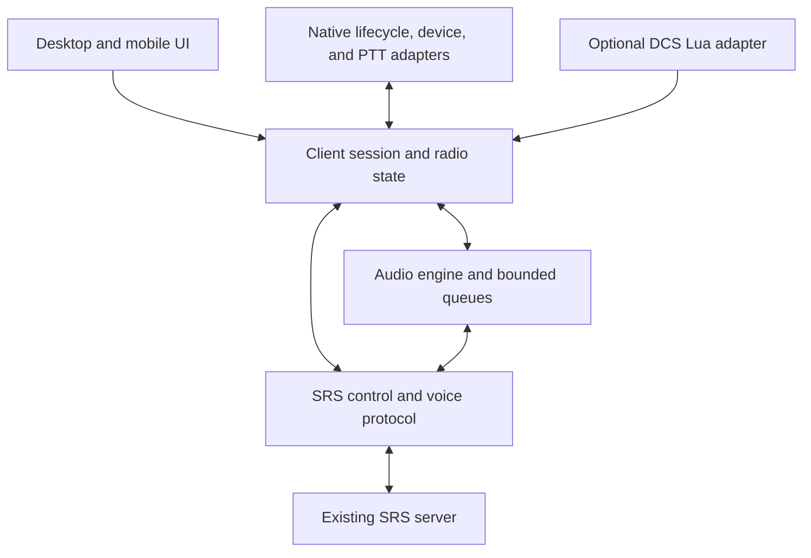

# Architecture

## Present implementation

`crates/srs-protocol` implements UDP voice packets and identity keepalives, a TCP control envelope, and bounded incremental newline framing. It has independent C# fixtures, malformed-input/regression tests, and fuzz entry points. Nested client/radio control payloads are preserved as JSON; typed domain rules are not implemented yet.

`crates/srs-client` implements a caller-driven Tokio TCP session, version checks, External AWACS Mode authentication, bounded peer/settings snapshots, and an 11-slot standalone radio state. Its stock-server probe verifies control interoperability with SRS 2.4.1.0. `crates/srs-core` remains a library scaffold; reusable radio eligibility and PTT rules are still planned. There are no voice sockets, codecs, audio devices, or UI. See [the session contract](docs/SESSION.md).

## Boundaries

| Planned component | Responsibility | Exclusions |
|---|---|---|
| `srs-core` | Radio identities, eligibility rules, PTT/session state, configuration models | UI, native device handles, network I/O |
| `srs-protocol` (implemented wire layer) | Bounded TCP JSON envelope/framing, UDP encoding/decoding, independent fixtures | Typed radio rules, device capture, sockets |
| `srs-client` (TCP/EAM implemented) | Session/authentication and control updates; reconnect and voice transport planned | UI framework dependencies, audio devices |
| `srs-audio` | Codec adapters, jitter buffer, resampling, mixing, effects, bounded audio queues | UI state mutation, unbounded buffering |
| Platform adapters | Audio I/O, device changes, hardware PTT, permissions, lifecycle | Duplicated radio/protocol rules |
| Application UI | Responsive radio console, settings, diagnostics | Codec and routing decisions in callbacks |
| DCS adapter | Existing Lua export/update interfaces, later cockpit support | Rewriting every aircraft script at bootstrap |
| Optional server/gateway | Later compatible Rust relay; separate iOS wake-up service if required | Dependency for the first desktop/Android client |

Add crates when they have a concrete responsibility and implementation. Do not create empty packages for every planned box.

## Candidate technologies

- Rust with Tokio and Serde for asynchronous control/network work.
- libopus through a narrow audited binding for the established voice codec.
- CPAL as the initial device I/O candidate, validated against native routing needs.
- Slint as the initial cross-platform UI candidate.
- Kotlin/Java and Swift/Objective-C adapters where native lifecycle APIs require them.

Serde/serde_json and Tokio are used and locked in Cargo.lock. Tokio's enabled features cover TCP, buffered I/O, timing, and a runtime; the library does not spawn background tasks. Codec/device bindings and UI dependencies remain candidates. Confirm device/UI choices through a physical-device spike. Shared Rust does not remove platform-specific audio-session work. libfuzzer-sys is isolated in a separate development-only fuzz workspace.

## Threading and ownership

The client session owns connection state and applies typed commands/events. UI and platform adapters send commands rather than mutating shared global state. Audio callbacks consume/produce preallocated buffers through bounded queues. Encoding, decoding, network operations, logging, and configuration persistence execute outside hardware callbacks. Define queue limits and drop policy before wiring the audio path.

PTT is an explicit state machine. Disconnect, device failure, lifecycle interruption, and lost input ownership release transmission. Reconnect starts receive-only until a new valid transmit action. Distinguish microphone capture, local TX, server connectivity, and any available delivery evidence.

## Compatibility

The [protocol guide](docs/PROTOCOL.md) pins the initial reference and records known wire details. Use independent upstream fixtures and differential tests. Separate application version, settings schema, and SRS compatibility declaration. Preserve server policy; do not assume all servers permit external coalition operators.

DCS cockpit/terrain state belongs to a later adapter. A phone in TOC mode does not have a local DCS terrain engine. Desktop DCS integration and mobile standalone radio operation have different acceptance criteria.

## Repository layout

- Root Markdown: onboarding, agent rules, architecture, tasks, notices.
- `docs/`: scope, protocol, testing, platform, UI, reporting, and release guides.
- `crates/srs-core/`: the radio-domain scaffold.
- `crates/srs-protocol/`: wire codecs, tests, fixtures, and an offline round-trip example.
- `crates/srs-client/`: TCP/EAM session, local radio state, loopback tests, and stock-server probe.
- `scripts/test_stock_server.py`: checksum-pinned official server verification in an isolated Linux network.
- `tools/reference-fixtures/`: .NET harness linking unchanged external upstream sources.
- `scripts/reference_fixtures.py`: pinned-source and independent-fixture verification.
- `fuzz/`: isolated voice/control libFuzzer targets.
- `scripts/check.py`: standard-library Python driver for documentation and Cargo checks.
- `.github/`: CI and issue/PR templates.

Keep this inventory synchronized when actual modules are added.
