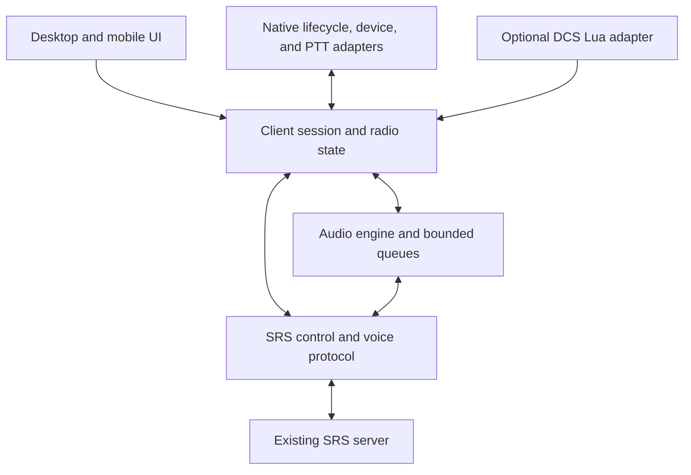

# Architecture

## Present implementation

`crates/srs-protocol` implements UDP voice packets and identity keepalives, a TCP control envelope, and bounded incremental newline framing. It has independent C# fixtures, malformed-input/regression tests, and fuzz entry points. Nested peer client/radio control payloads are preserved as JSON. Local receive rules live in `srs-core`.

`crates/srs-client` implements a caller-driven Tokio TCP session, version checks, External AWACS Mode authentication, bounded peer/settings snapshots, and an 11-slot standalone radio state. Its stock-server probe verifies control interoperability with SRS 2.4.1.0. `crates/srs-core` implements pure receive-radio eligibility with independent C# cases. `srs-client::voice` adds UDP registration/keepalives, bounded receive, and PTT invalidation tied to the exact TCP connection and radio authorization revision. `srs-audio` wraps Opus encoding/decoding with fixed buffers. Generated audio passes through the stock server and the original C# codec wrappers. `srs-client::receive` applies current radio/key/PTT policy and owns up to 16 original-speaker jitter/decoder states. `srs-audio::jitter` reorders before decoding and bounds latency, queues, and concealment. `srs-device` now provides an explicit CPAL desktop adapter, bounded callback bridges, capture permits, a 48-to-16 kHz FIR, and local tone/capture/codec-loopback probes. Physical devices and integrated session/PTT orchestration remain unvalidated; hardware PTT and UI remain pending. See [device contract](docs/DEVICES.md). See [receive behavior](docs/RECEIVE.md). See [the session contract](docs/SESSION.md) and [voice contract](docs/VOICE.md).

## Boundaries

| Planned component | Responsibility | Exclusions |
|---|---|---|
| `srs-core` (receive matching implemented) | Pure radio/key/intercom eligibility; further domain models planned | UI, native device handles, network I/O |
| `srs-protocol` (implemented wire layer) | Bounded TCP JSON envelope/framing, UDP encoding/decoding, independent fixtures | Typed radio rules, device capture, sockets |
| `srs-client` (TCP/EAM/UDP implemented) | Control state, UDP transport, session-bound PTT and receive gating; reconnect planned | UI framework dependencies, audio devices, automatic playback |
| `srs-audio` (Opus and jitter implemented) | Fixed-frame codec, bounded sequence/jitter/PLC; mixing, resampling/effects, and device queues planned | Device handles, UI state mutation, unbounded buffering |
| `srs-device` (desktop probe implemented) | Explicit native input/output, bounded callback queues, capture permits and conversion; device/session orchestration, hardware PTT, permissions/lifecycle adapters pending | Duplicated radio/protocol rules |
| Application UI | Responsive radio console, settings, diagnostics | Codec and routing decisions in callbacks |
| DCS adapter | Existing Lua export/update interfaces, later cockpit support | Rewriting every aircraft script at bootstrap |
| Optional server/gateway | Later compatible Rust relay; separate iOS wake-up service if required | Dependency for the first desktop/Android client |

Add crates when they have a concrete responsibility and implementation. Do not create empty packages for every planned box.

## Candidate technologies

- Rust with Tokio and Serde for asynchronous control/network work.
- libopus through a narrow audited binding for the established voice codec.
- CPAL 0.18.2 for the first desktop device adapter; physical native routing validation remains pending.
- Slint as the initial cross-platform UI candidate.
- Kotlin/Java and Swift/Objective-C adapters where native lifecycle APIs require them.

Serde/serde_json and Tokio are used and locked in Cargo.lock. Tokio's enabled features cover TCP/UDP, buffered I/O, bounded latest-value watch channels, timing, and a runtime; the library does not spawn background tasks. Opus uses the safe `opus` binding and bundled libopus 1.6.1 through opusic-sys. The device adapter locks CPAL 0.18.2 and rtrb 0.4.1; allocation-counter 0.8.1 is test-only. UI dependencies remain candidates. Confirm device/UI choices through a physical-device spike. Shared Rust does not remove platform-specific audio-session work. libfuzzer-sys is isolated in a separate development-only fuzz workspace.

## Threading and ownership

The client session owns connection state and applies typed commands/events. UI and platform adapters send commands rather than mutating shared global state. Audio callbacks consume/produce preallocated buffers through bounded queues. Encoding, decoding, network operations, logging, and configuration persistence execute outside hardware callbacks. Define queue limits and drop policy before wiring the audio path.

PTT is an explicit state machine. Disconnect, device failure, lifecycle interruption, and lost input ownership release transmission. Reconnect starts receive-only until a new valid transmit action. Distinguish microphone capture, local TX, server connectivity, and any available delivery evidence.

## Compatibility

The [protocol guide](docs/PROTOCOL.md) pins the initial reference and records known wire details. Use independent upstream fixtures and differential tests. Separate application version, settings schema, and SRS compatibility declaration. Preserve server policy; do not assume all servers permit external coalition operators.

DCS cockpit/terrain state belongs to a later adapter. A phone in TOC mode does not have a local DCS terrain engine. Desktop DCS integration and mobile standalone radio operation have different acceptance criteria.

## Repository layout

- Root Markdown: onboarding, agent rules, architecture, tasks, notices.
- `docs/`: scope, protocol, testing, platform, UI, reporting, and release guides.
- `crates/srs-core/`: pure receive matching and independent C# matcher cases.
- `crates/srs-protocol/`: wire codecs, tests, fixtures, and an offline round-trip example.
- `crates/srs-client/`: TCP/EAM session, UDP voice/PTT gating, local radio state, and stock-server probes.
- `crates/srs-audio/`: fixed-frame Opus, bounded jitter buffer, impairment simulations, and offline codec/load probes.
- `crates/srs-device/`: native device ownership, bounded callback bridges, FIR conversion, local audio probe, and simulated load probe.
- `scripts/test_null_audio.py`: process-local ALSA null device verification without hardware.
- `tools/voice-reference/`: unchanged upstream C# codec wrappers linked into a generated-signal harness.
- `scripts/test_reference_codec.py`: bidirectional Rust/C# codec verification.
- `scripts/test_stock_server.py`: checksum-pinned official server verification in an isolated Linux network.
- `tools/reference-fixtures/`: .NET harness linking unchanged external upstream sources.
- `scripts/reference_fixtures.py`: pinned-source and independent-fixture verification.
- `fuzz/`: isolated voice/control libFuzzer targets.
- `scripts/check.py`: standard-library Python driver for documentation and Cargo checks.
- `.github/`: CI and issue/PR templates.

Keep this inventory synchronized when actual modules are added.
